# Global-Smile 2026 - VBA Code Flow

> Companion to `VBA_CODEBASE.md`. This document maps triggers, procedure calls, data movement and fail-closed gates for the v8.5 VBA export in `build/v8_5_vba/`.
>
> The graphs are static views derived from the source. They describe what the code is written to do; they do not prove that a live Excel refresh passes. Use Excel Desktop/COM for runtime verification.

## 1. Legend and scope

- Solid arrows are direct calls or data writes.
- Dashed arrows are lazy/optional paths, or paths that are present but not on the active GL route.
- `modX.Proc` means a call qualified by module; unqualified names inside a module resolve locally or to a public procedure in another module.
- `HOLD` means the fail-closed path: the audit row is written and the visible GL is not modified.
- `Legacy` means code that is compiled but not called by the active `ScanGL` path.

The active accounting path is:

```text
Workbook open -> modEngine.InitializeEngine
PJ / PJ Non-Vat edits -> modEngine.SyncPJToCDJ / SyncPJNonVatToCDJ -> CDJ
SJ edits -> modEngine.SyncSJToCRJ -> CRJ
RefreshGL / RunV8Gate -> modGLScanEngine.ScanGL -> GL + GL_AUDIT
```

The workbook has 15 non-empty VBA components with 146 declared procedures. `modEngine` is the largest module (76 procedures) and the highest fan-in point.

## 2. Entry-point catalogue

| Entry point | Component | First call | Downstream work | Writes |
|---|---|---|---|---|
| Workbook open | `ThisWorkbook.Workbook_Open` | `modEngine.InitializeEngine("CDJ")` | Load suppliers, CDJ headers, CDJ references, sequence, next row | none |
| PJ value edit | `Sheet12.Worksheet_Change` | `LookupByTIN` / `LookupByName` / `CalculateTotals` | Supplier lookup, VAT formulas, PJ reference, CDJ sync | PJ, CDJ |
| PJ Non-Vat value edit | `Sheet11.Worksheet_Change` | same helper pattern | Supplier lookup, non-VAT amount, PNV reference, CDJ sync | PJ Non-Vat, CDJ |
| PJ Non-Vat2 value edit | `Sheet9.Worksheet_Change` | `modPJSync` helpers | Legacy lookup, totals, PNV reference, direct CDJ sync | PJ Non-Vat2, CDJ |
| SJ value edit | `Sheet3.Worksheet_Change` | `LookupCustomer` / `GetNextInvoiceNumber` | Customer defaults, VAT/net formulas, invoice ID, CRJ sync | SJ, CRJ |
| SJ2 value edit | `Sheet8.Worksheet_Change` | `GetNextInvoiceNumber` / `SyncToCRJ` | Same sales formulas and CRJ sync with alternate numbering | SJ2, CRJ |
| Manual SJ sync | `Sheet3.ManualSyncToCRJ` | `modEngine.SyncSJToCRJ` | Sync active SJ row to CRJ | CRJ |
| Manual PJ sync | `Sheet11.ManualSyncToCDJ` / `Sheet12.ManualSyncToCDJ` | `modEngine.SyncPJNonVatToCDJ` / `SyncPJToCDJ` | Sync active PJ row to CDJ | CDJ |
| GL refresh | `modGLRefresh.RefreshGL` (and wrappers) | `modGLScanEngine.ScanGL(2026)` | Validate, scan CDJ/CRJ, gate, write GL | GL, GL_AUDIT |
| GL gate | `modGLGate.RunV8Gate` | `ValidateV8Structure` | Structure check, then `ScanGL 2026` | GL, GL_AUDIT |
| Chart utility | `modGraphify.Graphify` | local helpers | Chart active sheet numeric column | chart object only |
| Supplier seeder | `ImportSuppliersFromJSON` | none | Clear and rewrite SUPPLIERS DATA | SUPPLIERS DATA |
| Duplicate check | `Sheet10.CheckDuplicates` | none | Compare Name + Address pairs | nothing (Immediate Window / MsgBox) |
| Engine diagnostics/reset | `modEngine.Show*`, `RepairEngine`, `ResetCDJ`, `ResetCRJ` | loaders | Inspect or reset caches/counters | CDJ/CRJ counters or data |

## 3. System context

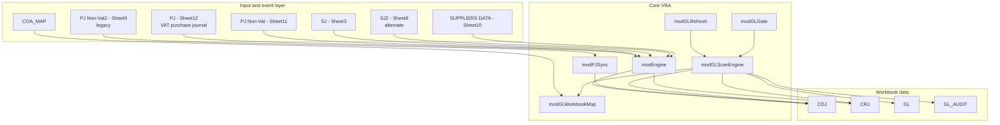

The important separation is:

1. **Event layer** (`Sheet3`, `Sheet8`, `Sheet9`, `Sheet11`, `Sheet12`, `ThisWorkbook`) handles Excel edits and calls the engine.
2. **Posting layer** (`modEngine`, `modPJSync`) owns supplier caches, reference caches, sequence numbers and row placement.
3. **GL layer** (`modGLRefresh`, `modGLGate`, `modGLScanEngine`, `modGLWorkbookMap`) is a separate read-only scan of CDJ/CRJ followed by a gated write to the existing `GL` sheet.
4. **Utilities** (`modGraphify`, `ImportSuppliersFromJSON`, `Sheet10.CheckDuplicates`) are standalone and not part of the posting or GL flow.

## 4. Startup and initialization

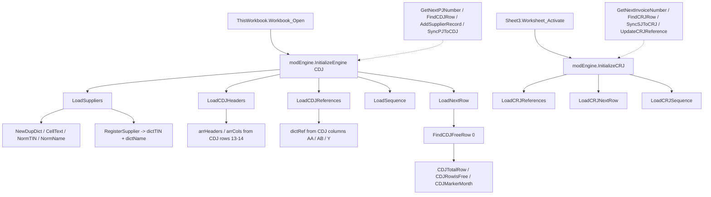

Initialization facts:

- `InitializeEngine` is idempotent only in the sense that it rebuilds the dictionaries each time it is called. The public helpers call it again if `gInitialized` is false.
- `InitializeCRJ` returns immediately when `gInitializedCRJ` is true.
- `LoadNextRow` deliberately ignores the static pointer in `AA14` and calls `FindCDJFreeRow(0)`; this avoids the known drift where the static pointer pointed past the last monthly partition.
- `Workbook_Open` does not initialize CRJ caches; they are lazy-loaded by sales-journal activity or by a CRJ helper call.

## 5. Purchase journal to CDJ

### 5.1 Event orchestration (VAT and Non-VAT)

```mermaid
sequenceDiagram
    autonumber
    actor User
    participant PJ as PJ sheet
    participant Engine as modEngine
    participant Sup as SUPPLIERS DATA
    participant CDJ as CDJ
    User->>PJ: edit TIN, name, COA, gross amount
    alt TIN or name changed
        PJ->>Engine: GetSupplierByTIN / GetSupplierByName
        Engine->>Sup: LoadSuppliers or ReloadSuppliers
        alt supplier found
            Sup-->>Engine: name, address, COA
            Engine-->>PJ: Array(name, address, coa, tin)
            PJ->>PJ: write supplier name, address, COA
        else TIN shared by different suppliers
            Engine-->>PJ: False and ambiguous list
            PJ-->>User: MsgBox, stop; correct SUPPLIERS DATA
        else not found
            PJ-->>User: ask "Add?"
            User-->>PJ: Yes
            PJ->>Engine: AddSupplierRecord
            Engine->>Sup: validate, append row, verify
            Engine-->>PJ: success or explanatory message
        end
    end
    alt gross amount present and TIN, name, COA are present
        PJ->>Engine: GetNextPJNumber
        Engine-->>PJ: next sequence
        PJ->>PJ: stamp PJ-##### or PNV-##### plus full ID
        PJ->>Engine: SyncPJToCDJ or SyncPJNonVatToCDJ
        Engine->>Engine: FindExpenseColumn
        Engine->>Engine: CalculateWithholdingTax or CalculateEWT
        alt reference already in CDJ
            Engine->>CDJ: update existing row
        else new reference
            Engine->>Engine: PJMonthOf / CDJMarkerMonth
            Engine->>Engine: CDJReserveRow
            Engine->>CDJ: insert or allocate row, write row
        end
    end
```

### 5.2 VAT vs Non-VAT differences

| Behaviour | PJ (Sheet12) | PJ Non-Vat (Sheet11) |
|---|---|---|
| Trigger columns | B, D, E, F, G, N, H | Same pattern |
| Amount treatment | `J = N / 1.12`; `M = N - J` | `J = N`; `M = 0` |
| Reference prefix | `PJ-#####` | `PNV-#####` |
| Full ID prefix | `PJINV-` | `PNVINV-` |
| Engine sync | `modEngine.SyncPJToCDJ` | `modEngine.SyncPJNonVatToCDJ` |
| EWT | `CalculateWithholdingTax` | `CalculateEWT` |
| Supplier add | `AddSupplierRecord` | `AddSupplierRecord` |

Both sheets duplicate `GetCOAList`, `SelectCOA`, `LookupByTIN`, `LookupByName`, `ClearSupplierRow`, `CalculateTotals`, `FindBlockStart`, `ManualSyncToCDJ` and `Worksheet_Change`. Any fix to the lookup or event logic must be applied to both modules.

### 5.3 CDJ row placement

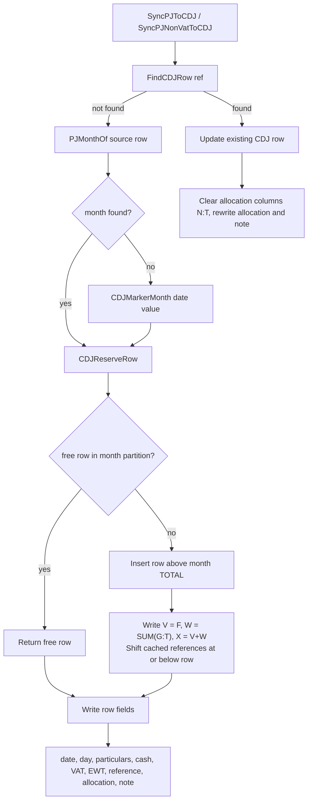

The placement rule is the core defence against the reported "row lands outside every monthly total" defect:

- `FindCDJFreeRow(month)` scans only inside that month's block.
- If no free row exists, `CDJReserveRow` inserts directly above the month's TOTAL row so Excel expands the SUM range.
- If the month cannot be found, `CDJReserveRow` returns `0`, and the sync exits without writing. This is a fail-closed path.
- `ShiftCDJRefCache` increments every cached CDJ reference at or below the inserted row.

### 5.4 Legacy PJ Non-Vat2 path

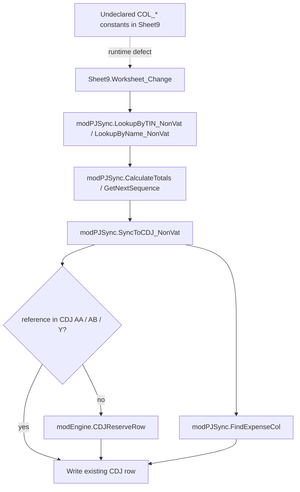

This path is compiled but not reliable. `Sheet9` has no `Option Explicit` and does not declare its `COL_*` constants, so the event logic does not resolve the intended columns. The active non-VAT path is Sheet11 plus `modEngine.SyncPJNonVatToCDJ`.

## 6. Sales journal to CRJ

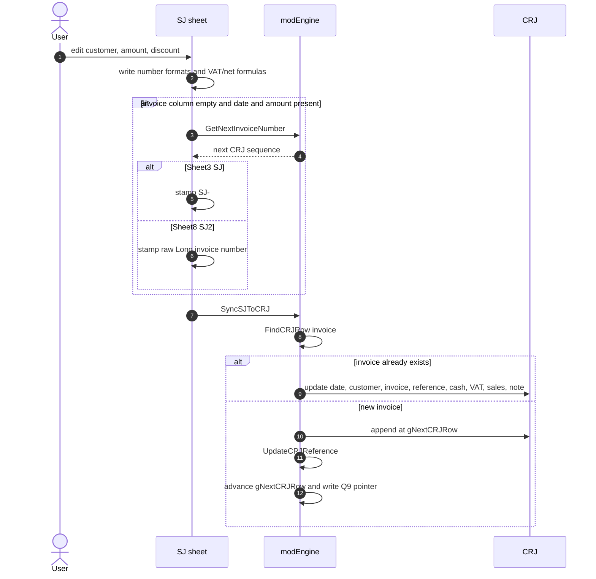

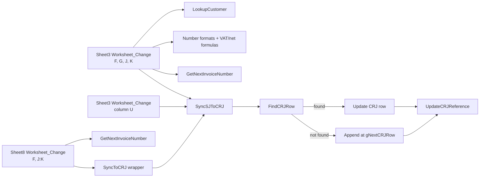

Differences between the two sales implementations:

- Sheet3 writes a formatted `SJ-#####` invoice key and a `SJINV-...` full ID.
- Sheet8 writes the raw Long sequence returned by `GetNextInvoiceNumber`, so the CRJ key format differs from Sheet3.
- Sheet3 checks the TOTAL row in column E; Sheet8 checks column A. Confirm the SJ2 layout before relying on Sheet8.
- Both eventually call `modEngine.SyncSJToCRJ`, so the CRJ write layout is shared.

## 7. GL scan and refresh

### 7.1 Entry points

| Public entry point | Module | Call |
|---|---|---|
| `RefreshGL` | `modGLRefresh` | `ScanGL 2026` |
| `RefreshAllGL` | `modGLRefresh` | `ScanGL 2026` |
| `RefreshGLIntoSheet` | `modGLRefresh` | `ScanGL 2026` |
| `RefreshGLForYear(yearNumber)` | `modGLRefresh` | `ScanGL yearNumber` |
| `RunV8Gate` | `modGLGate` | `ValidateV8Structure`, then `ScanGL 2026` |
| `ScanGL(yearNumber)` | `modGLScanEngine` | direct scan (default 2026) |

All of these converge on `modGLScanEngine.ScanGL`. The year parameter is passed down but is not used by the CDJ/CRJ scanners; see the observations in `VBA_CODEBASE.md`.

### 7.2 Main scan flow

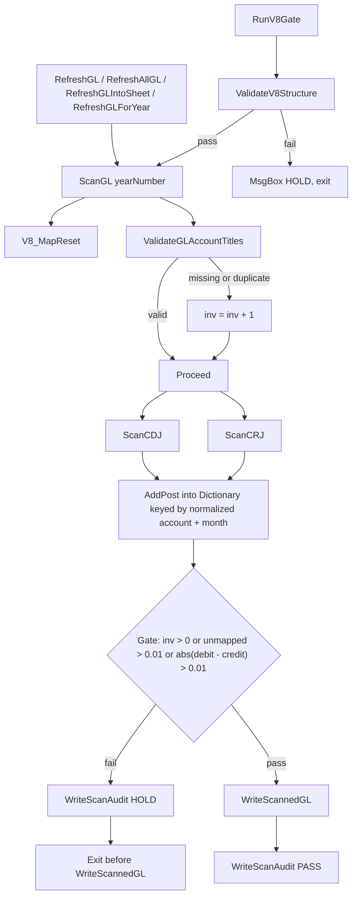

### 7.3 Scan sequence

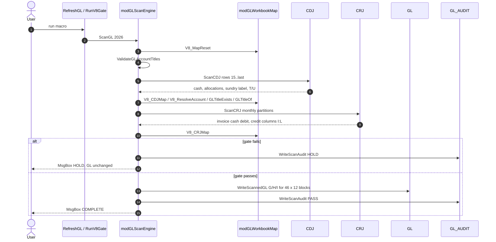

### 7.4 CDJ scan detail

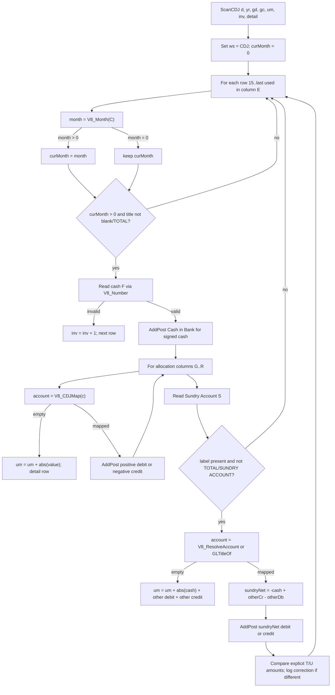

Key details:

- Month attribution uses column C and carries the last recognized month forward. A row with a blank or non-month date inherits the current block month.
- Cash is signed: positive -> debit `Cash in Bank`; negative -> credit `Cash in Bank`.
- Allocation columns G:R are mapped by fixed column number (`V8_CDJMap`), not by header text.
- The Sundry amount is derived from the balanced row (`-cash + otherCr - otherDb`) rather than trusting the visible T/U values. A discrepancy is logged in `GL_AUDIT` detail but does not increment `inv`.
- Non-numeric values in cash or allocation cells increment `inv` and skip the balance of that row; the gate then prevents write-back.

### 7.5 CRJ scan detail

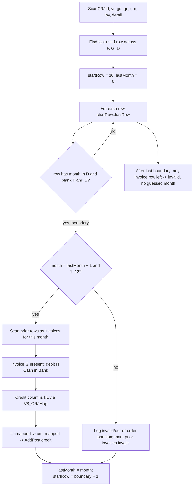

CRJ does not use the timestamp in column O for month attribution. It uses the visible monthly partition boundaries. This is deliberate because column O contains SJ import/log timestamps, not transaction dates.

### 7.6 Gate conditions

`ScanGL` writes HOLD and exits before touching GL when any of these is true:

| Condition | Source of count | Effect |
|---|---|---|
| Missing or duplicate GL account title | `ValidateGLAccountTitles` increments `inv` | HOLD |
| Non-numeric cash or allocation value | `ScanCDJ` / `ScanCRJ` increments `inv` | HOLD |
| Invoice after last monthly boundary | `ScanCRJ` increments `inv` | HOLD |
| Invalid or out-of-order CRJ partition | `ScanCRJ` increments `inv` | HOLD |
| Nonzero allocation with no account mapping | `um` accumulates absolute value | HOLD if `um > TOLERANCE` |
| Debit and credit totals differ | `Abs(gd - gc) > TOLERANCE` | HOLD |

On the pass path, `WriteScannedGL` writes the G/H/I cells for 46 account blocks x 12 months, then `WriteScanAudit` appends a PASS row. On the hold path, only the audit row is written; the GL cells are left untouched.

### 7.7 GL write layout

```text
GL:
  row 11       header row; F11 = "ACCOUNT TITLE"
  block b      13 + b * 13, for b = 0..45
  block b row  month row = 13 + b * 13 + (m - 1), m = 1..12
  column F      account title
  column G      debit
  column H      credit
  column I      running balance within the block (starts at 0)
```

`WriteScannedGL` reads the title from column F for each block, looks up dictionary key `V8_Norm(title) & "|" & month`, and writes G/H. It raises an error if a title is blank. It does not carry a prior-year opening balance into January.

## 8. Account resolution and mapping

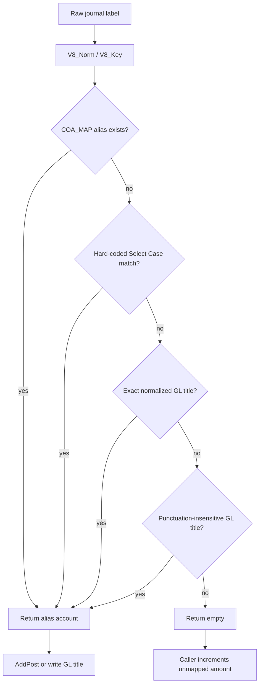

`EnsureMaps` builds the lookup tables:

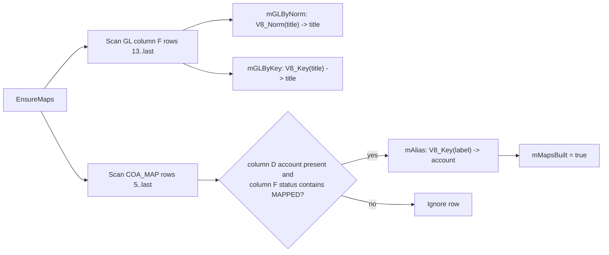

Static-analysis warning: the status test is `InStr(st, "MAPPED") > 0`. `UNMAPPED` also contains `MAPPED`, so an `UNMAPPED` row would be accepted. This conflicts with the fail-closed intent and should be tightened to an exact status match.

### 8.1 Fixed column maps

| Map | Columns | Accounts |
|---|---|---|
| `V8_CDJMap` | 7, 8, 9, 10, 11, 12, 13, 14, 15, 16, 17, 18 | Input VAT, EWT Payable, Petty Cash Fund, Government Contributions (EE), Government Loans (EE), De Minimis, Salaries and Wages, Clinic Material and Supplies, Rent, Gas/Oil/Parking/Toll Fees, Light and Water Expense, Professional Fees |
| `V8_CRJMap` | 9, 10, 11, 12 | Excess CWT Over IT, VAT Payable, Sales, Sales |
| `V8_ResolveAccount` hard-coded | label text | Transportation and Travel, Advances to Employees, Repair and Maintenance, VAT Payable, Clinic Material and Supplies, Dental Equipment, Miscellaneous, plus the clinic-supplies/medical-equipment variants |

The hard-coded aliases are executable at runtime. They are not the same thing as an accounting approval; see the policy note in `VBA_CODEBASE.md`.

## 9. Supplier lookup and add

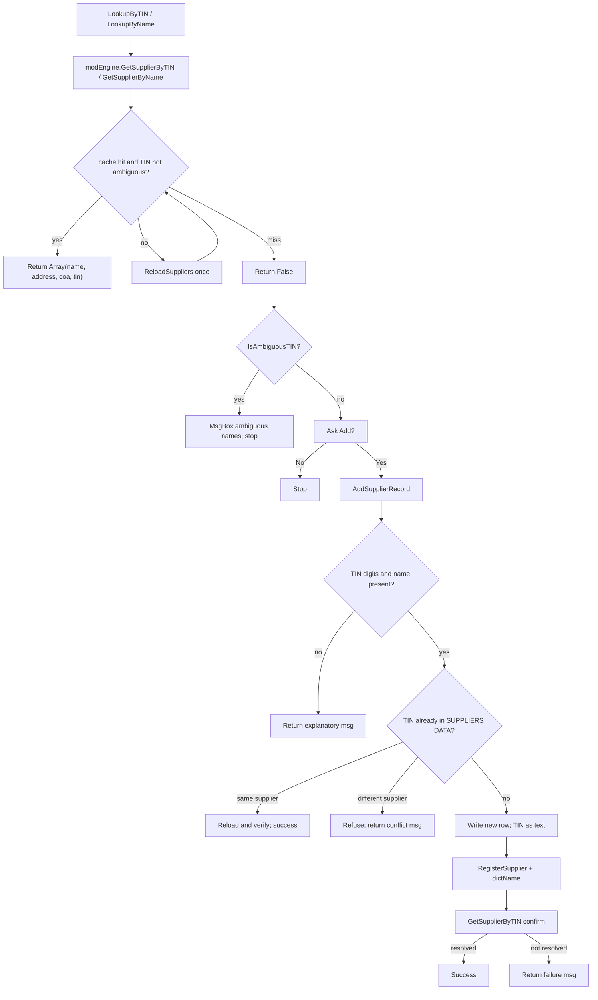

The lookup design is intentionally fail-closed:

- A TIN shared by different supplier names is never guessed; `IsAmbiguousTIN` and `AmbiguousNamesFor` stop the add path.
- Identical repeat rows for the same supplier are not treated as ambiguous.
- A cache miss triggers exactly one `ReloadSuppliers` before returning False.
- `AddSupplierRecord` writes to SUPPLIERS DATA, updates caches, and confirms the TIN resolves before reporting success.

## 10. Procedure-level call graphs

### 10.1 `modEngine` - initialization, cache and supplier graph

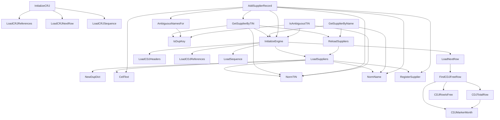

### 10.2 `modEngine` - sync and CDJ placement graph

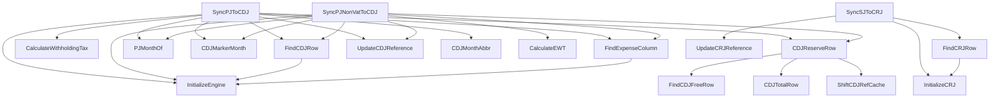

### 10.3 `modEngine` - legacy GL graph

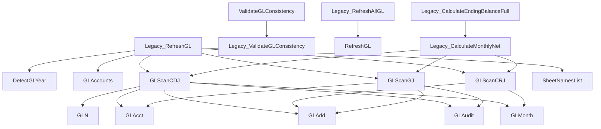

This graph is deliberately marked legacy. The active route does not call `GLScanGJ`, `Legacy_RefreshGL`, `Legacy_Calculate*` or `BuildV8CalcSheet`. The presence of these routines means a full code review must distinguish "compiled" from "reachable from the active macro path."

### 10.4 `modGLScanEngine`

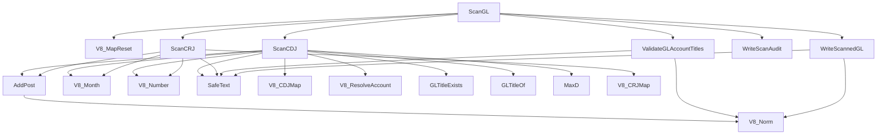

### 10.5 `modGLWorkbookMap`

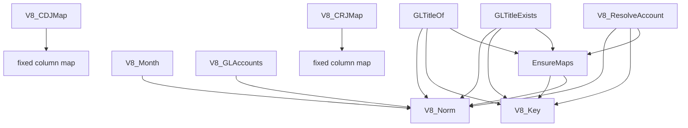

### 10.6 `modPJSync`

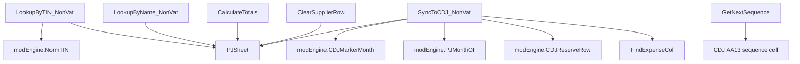

Only Sheet9 calls this module in the current project. Sheet11/12 use `modEngine` directly.

### 10.7 Worksheet event modules

```mermaid
flowchart LR
    subgraph PJ["PJ and PJ Non-Vat"]
        S12["Sheet12.Worksheet_Change"] --> GCOA1["GetCOAList / SelectCOA"]
        S12 --> LBT1["LookupByTIN / LookupByName"]
        S12 --> CT1["CalculateTotals / FindBlockStart"]
        S12 --> GPJ["modEngine.GetNextPJNumber"]
        S12 --> SPJ["modEngine.SyncPJToCDJ"]
        S11["Sheet11.Worksheet_Change"] --> GCOA2["GetCOAList / SelectCOA"]
        S11 --> LBT2["LookupByTIN / LookupByName"]
        S11 --> CT2["CalculateTotals / FindBlockStart"]
        S11 --> GPNV["modEngine.GetNextPJNumber"]
        S11 --> SPNV["modEngine.SyncPJNonVatToCDJ"]
    end
    subgraph SJ["Sales journals"]
        S3["Sheet3.Worksheet_Change"] --> LC["LookupCustomer"]
        S3 --> GINV["modEngine.GetNextInvoiceNumber"]
        S3 --> SSJ["modEngine.SyncSJToCRJ"]
        S3M["Sheet3.ManualSyncToCRJ"] --> SSJ
        S8["Sheet8.Worksheet_Change"] --> GINV2["modEngine.GetNextInvoiceNumber"]
        S8 --> WRAP["Sheet8.SyncToCRJ"]
        WRAP --> SSJ
    end
    subgraph LEG["Legacy and utilities"]
        S9["Sheet9.Worksheet_Change"] --> PJS["modPJSync helpers"]
        S10["Sheet10.CheckDuplicates"] --> SUP["SUPPLIERS DATA read"]
        IMP["ImportSuppliersFromJSON"] --> SUPWRITE["SUPPLIERS DATA clear/write"]
        GRA["modGraphify.Graphify"] --> CHART["chart object"]
    end
```

## 11. Cross-module dependency matrix

| Caller | `modEngine` | `modPJSync` | `modGLGate` | `modGLRefresh` | `modGLScanEngine` | `modGLWorkbookMap` |
|---|---|---|---|---|---|---|
| `ThisWorkbook` | `InitializeEngine` | - | - | - | - | - |
| `Sheet12` (PJ) | `LookupByTIN`, `LookupByName`, `AddSupplierRecord`, `GetNextPJNumber`, `SyncPJToCDJ` | - | - | - | - | - |
| `Sheet11` (PJ Non-Vat) | Same, plus `SyncPJNonVatToCDJ` | - | - | - | - | - |
| `Sheet9` (PJ Non-Vat2) | `NormTIN`, `CDJMarkerMonth`, `PJMonthOf`, `CDJReserveRow` | `Lookup*_NonVat`, `CalculateTotals`, `GetNextSequence`, `SyncToCDJ_NonVat` | - | - | - | - |
| `Sheet3` (SJ) | `InitializeCRJ`, `GetNextInvoiceNumber`, `SyncSJToCRJ` | - | - | - | - | - |
| `Sheet8` (SJ2) | `GetNextInvoiceNumber`, `SyncSJToCRJ` | - | - | - | - | - |
| `Sheet10` | - | - | - | - | - | - |
| `modEngine` | self | - | - | `RefreshGL` (legacy wrapper) | - | `V8_Month`; `GL_SHEET` constants |
| `modPJSync` | `NormTIN`, `CDJMarkerMonth`, `PJMonthOf`, `CDJReserveRow` | self | - | - | - | - |
| `modGLGate` | - | - | self | - | `ScanGL` | `V8_Norm` |
| `modGLRefresh` | - | - | - | self | `ScanGL` | - |
| `modGLScanEngine` | - | - | - | - | self | `V8_MapReset`, `V8_CDJMap`, `V8_CRJMap`, `V8_ResolveAccount`, `V8_Month`, `V8_Number`, `V8_Norm`, `GLTitle*` |
| `modGLWorkbookMap` | - | - | - | - | - | self |
| `modGraphify` | - | - | - | - | - | - |
| `ImportSuppliersFromJSON` | - | - | - | - | - | - |

## 12. Data layout and column flow

### 12.1 CDJ

| Column | Letter | Use |
|---|---|---|
| 3 | C | Date / month marker used by `ScanCDJ` and `PJMonthOf` |
| 4 | D | Day |
| 5 | E | Particulars; blank/TOTAL rows are skipped |
| 6 | F | Cash; positive = debit, negative = credit |
| 7 | G | Input VAT allocation |
| 8 | H | EWT Payable allocation |
| 9 | I | Petty Cash Fund allocation |
| 10 | J | Government Contributions (EE) allocation |
| 11 | K | Government Loans (EE) allocation |
| 12 | L | De Minimis allocation |
| 13 | M | Salaries and Wages allocation |
| 14 | N | Clinic Material and Supplies allocation |
| 15 | O | Rent allocation |
| 16 | P | Gas, Oil, Parking, Toll Fees allocation |
| 17 | Q | Light and Water Expense allocation |
| 18 | R | Professional Fees allocation |
| 19 | S | Sundry Account label |
| 20 | T | Sundry Debit (used for comparison/correction, not trusted for the GL amount) |
| 21 | U | Sundry Credit (same) |
| 22 | V | Row balance formula `=F` |
| 23 | W | Row balance formula `=SUM(G:T)` |
| 24 | X | Row balance formula `=V+W` |
| 25 | Y | Legacy reference |
| 26 | Z | ENTRY LOGS note |
| 27 | AA | Canonical PJ reference |
| 28 | AB | PNV reference |

### 12.2 CRJ

| Column | Letter | Use |
|---|---|---|
| 4 | D | Date / monthly partition boundary label |
| 6 | F | Customer; blank on a boundary row |
| 7 | G | Invoice number; blank on a boundary row |
| 8 | H | Cash in Bank debit |
| 9 | I | Excess CWT Over IT |
| 10 | J | Output VAT / VAT Payable credit |
| 11 | K | Exempt / Sales credit |
| 12 | L | Sales credit |
| 15 | O | Note / SJ import timestamp (not used for month attribution) |
| 16 | P | Reference |
| 17 | Q | Sequence / next-row pointer |

### 12.3 PJ / PJ Non-Vat

| Column | Letter | Use |
|---|---|---|
| 4 | D | TIN |
| 5 | E | Supplier name |
| 6 | F | Address |
| 7 | G | COA / description |
| 8 | H | Reference |
| 9 | I | Debit mirror |
| 10 | J | Debit / net amount |
| 12 | L | Credit mirror |
| 13 | M | Credit / VAT |
| 14 | N | Gross amount |
| 17 | Q | Full transaction ID |

### 12.4 SJ / SJ2

| Column | Letter | Use |
|---|---|---|
| 3 | C | Date |
| 6 | F | Customer |
| 7 | G | Customer address |
| 8 | H | Description |
| 9 | I | Physical invoice (manual; not overwritten by Sheet3) |
| 10 | J | Amount |
| 11 | K | Discount |
| 12 | L | Output VAT mirror |
| 13 | M | Output VAT |
| 14 | N | Net sales mirror |
| 15 | O | Net sales |
| 21 | U | Auto invoice key (`SJ-#####` on Sheet3) |
| 22 | V | Full ID (`SJINV-...` on Sheet3) |

### 12.5 GL, GL_AUDIT, COA_MAP, SUPPLIERS DATA

| Sheet | Layout |
|---|---|
| `GL` | F = account title; G = debit; H = credit; I = running balance; 46 blocks starting at row 13 with stride 13; F11 header |
| `GL_AUDIT` | A = timestamp; B = `PASS`/`HOLD`; C = summary; D = detail (truncated to 32,000 characters) |
| `COA_MAP` | A = source label; D = account; F = status; aliases read from row 5 onward |
| `SUPPLIERS DATA` | B = number; C = TIN; D = supplier name; E = address; F = COA |

### 12.6 Legacy PJ Non-Vat2

| Column | Letter | Use |
|---|---|---|
| 4 | D | TIN |
| 5 | E | Name |
| 6 | F | Address |
| 7 | G | Description |
| 8 | H | UOM |
| 9 | I | Amount |
| 10 | J | Debit |
| 11 | K | Debit mirror |
| 12 | L | EWT |
| 13 | M | VAT |
| 14 | N | Reference |
| 15 | O | COA |
| 16 | P | Full ID |

The legacy Sheet9 code uses undeclared `COL_*` names, so the table above describes the intended `modPJSync` layout, not a reliable runtime behaviour.

## 13. Failure and HOLD paths

```mermaid
flowchart TD
    A["Operation"] --> B{"Failure class"}
    B -->|workbook layout| C["ValidateV8Structure fails"]
    C --> C1["MsgBox HOLD; no scan"]
    B -->|GL title duplicate/missing| D["ValidateGLAccountTitles -> inv > 0"]
    D --> D1["Scan continues for audit, then WriteScanAudit HOLD"]
    B -->|unmapped allocation/sundry| E["um > TOLERANCE"]
    E --> E1["WriteScanAudit HOLD; GL unchanged"]
    B -->|debit/credit imbalance| F["abs(gd - gc) > TOLERANCE"]
    F --> F1["WriteScanAudit HOLD; GL unchanged"]
    B -->|CRJ partition invalid| G["inv increments; detail row"]
    G --> G1["WriteScanAudit HOLD"]
    B -->|no legal CDJ row| H["CDJReserveRow returns 0"]
    H --> H1["Sync exits without writing"]
    B -->|ambiguous supplier TIN| I["IsAmbiguousTIN true"]
    I --> I1["Stop; no supplier guess, no add"]
    B -->|supplier sync write error| J["Empty ErrorHandler in modEngine syncs"]
    J --> J1["Error swallowed; source and CDJ/CRJ may diverge"]
```

The first five paths are deliberately fail-closed. The last one is the opposite: the public sync routines do not report write errors. A reviewer should treat "no message" as "no proof of a successful write" for those routines.

## 14. Legacy and dead paths

| Path | Status | Why it matters |
|---|---|---|
| `modEngine.GLScanGJ` | Compiled, not called by `ScanGL` | Keeps GJ parsing code in the project despite the CDJ/CRJ-only scope |
| `modEngine.Legacy_RefreshGL` | Private legacy writer | Writes a legacy matrix and can call GJ scan; not the active refresh |
| `modEngine.Legacy_CalculateMonthlyNet` | Private legacy helper | Re-scans sources and GJ; not used by `ScanGL` |
| `modEngine.Legacy_CalculateEndingBalanceFull` | Private legacy helper | Depends on `Legacy_CalculateMonthlyNet` |
| `modEngine.Legacy_ValidateGLConsistency` | Private legacy validator | Still used by public `ValidateGLConsistency` |
| `modEngine.Legacy_RefreshAllGL` | Private wrapper | Calls `RefreshGL`; not part of the scan engine |
| `modEngine.BuildV8CalcSheet` | Public but not on active path | Still checks `GL_V8_CALC`, the sheet the project says must not be recreated |
| `Sheet9` + `modPJSync` | Legacy PJ Non-Vat2 | Undeclared constants and duplicate logic; active path is Sheet11 |
| `Sheet8` | Alternate SJ | Different invoice key format from Sheet3 |
| `ImportSuppliersFromJSON` | Standalone destructive seeder | Not called by events, but present in the macro dialog |
| `modGraphify` | Standalone utility | No accounting role |

## 15. Static observations tied to flow

1. **The GL gate is in the right place.** `WriteScannedGL` is only reachable after the reconciliation/mapping gate passes. The audit row is written on both PASS and HOLD.
2. **The year parameter is not a filter.** `ScanCDJ` and `ScanCRJ` accept `yr` but do not use it. The scan is month-bucketed across whatever rows are present. CRJ additionally requires a January-first partition sequence.
3. **The GL balance is within-year.** `WriteScannedGL` resets `bal` for each block, so column I is Jan..Dec cumulative, not prior-year opening plus current activity.
4. **COA_MAP status matching is too loose.** `InStr(st, "MAPPED")` admits `UNMAPPED`; exact matching is required for a true fail-closed gate.
5. **Hard-coded aliases bypass the approval policy.** Several labels that the README says are not assumed approved are mapped in `V8_ResolveAccount`.
6. **Legacy code is still compiled.** `GLScanGJ`, `Legacy_*` and `BuildV8CalcSheet` are not on the active path but remain reachable by future edits or other macros.
7. **Sheet9 is not a safe fallback.** Its undeclared `COL_*` constants make the legacy non-VAT event path unreliable.
8. **Sync errors are silent.** The empty `ErrorHandler:` labels in `modEngine` mean a write failure does not raise a visible error.

## Appendix A - Extracted procedure call edges

This is the static adjacency list used to build the graphs above. Callee names are unqualified; cross-module calls are the public procedures with the same name. Obvious string-literal false positives were removed.

### A.1 Event and document modules

```text
ThisWorkbook!Workbook_Open -> InitializeEngine

Sheet12!CalculateTotals -> FindBlockStart
Sheet12!LookupByName -> AddSupplierRecord, GetSupplierByName, SelectCOA
Sheet12!LookupByTIN -> AddSupplierRecord, AmbiguousNamesFor, GetSupplierByTIN, IsAmbiguousTIN, SelectCOA
Sheet12!ManualSyncToCDJ -> SyncPJToCDJ
Sheet12!SelectCOA -> GetCOAList
Sheet12!Worksheet_Change -> CalculateTotals, ClearSupplierRow, GetNextPJNumber, LookupByName, LookupByTIN, SyncPJToCDJ

Sheet11!CalculateTotals -> FindBlockStart
Sheet11!LookupByName -> AddSupplierRecord, GetSupplierByName, SelectCOA
Sheet11!LookupByTIN -> AddSupplierRecord, AmbiguousNamesFor, GetSupplierByTIN, IsAmbiguousTIN, SelectCOA
Sheet11!ManualSyncToCDJ -> SyncPJNonVatToCDJ
Sheet11!SelectCOA -> GetCOAList
Sheet11!Worksheet_Change -> CalculateTotals, ClearSupplierRow, GetNextPJNumber, LookupByName, LookupByTIN, SyncPJNonVatToCDJ

Sheet3!ManualSyncToCRJ -> SheetExists, SyncSJToCRJ
Sheet3!Worksheet_Activate -> InitializeCRJ
Sheet3!Worksheet_Change -> GetNextInvoiceNumber, LookupCustomer, SheetExists, SyncSJToCRJ

Sheet8!SyncToCRJ -> SyncSJToCRJ
Sheet8!Worksheet_Change -> GetNextInvoiceNumber, SyncToCRJ

Sheet9!Worksheet_Change -> CalculateTotals, ClearSupplierRow, GetNextSequence, LookupByName_NonVat, LookupByTIN_NonVat, SyncToCDJ_NonVat
```

### A.2 `modEngine`

```text
modEngine!AddSupplierRecord -> AmbiguousNamesFor, CellText, GetSupplierByTIN, InitializeEngine, NormName, NormTIN, RegisterSupplier, ReloadSuppliers
modEngine!AddSupplierToCache -> InitializeEngine, NormName, NormTIN, RegisterSupplier
modEngine!AmbiguousNamesFor -> InitializeEngine, IsDupKey, NormTIN
modEngine!CDJMarkerMonth -> V8_Month
modEngine!CDJReserveRow -> CDJTotalRow, FindCDJFreeRow, ShiftCDJRefCache
modEngine!CDJTotalRow -> CDJMarkerMonth
modEngine!EngineStatus -> AmbiguousTINCount
modEngine!FindCDJFreeRow -> CDJMarkerMonth, CDJRowIsFree, CDJTotalRow
modEngine!FindCDJRow -> InitializeEngine
modEngine!FindCRJRow -> InitializeCRJ
modEngine!FindExpenseColumn -> InitializeEngine
modEngine!GLAcct -> GLN
modEngine!GLMonth -> GLN
modEngine!GLScanCDJ -> GLAcct, GLAdd, GLAudit, GLMonth, GLN
modEngine!GLScanCRJ -> GLAdd, GLMonth, GLN
modEngine!GLScanGJ -> GLAcct, GLAdd, GLAudit, GLMonth, GLN
modEngine!GetAccountFromCOA -> GLAcct
modEngine!GetAccountNameFromTIN -> NormTIN
modEngine!GetNextInvoiceNumber -> InitializeCRJ
modEngine!GetNextPJNumber -> InitializeEngine
modEngine!GetNextSeq -> GetNextPJNumber
modEngine!GetSupplierByName -> InitializeEngine, NormName, ReloadSuppliers
modEngine!GetSupplierByTIN -> InitializeEngine, IsDupKey, NormTIN, ReloadSuppliers
modEngine!InitializeCRJ -> LoadCRJNextRow, LoadCRJReferences, LoadCRJSequence
modEngine!InitializeEngine -> LoadCDJHeaders, LoadCDJReferences, LoadNextRow, LoadSequence, LoadSuppliers
modEngine!IsAmbiguousTIN -> InitializeEngine, IsDupKey, NormTIN
modEngine!Legacy_CalculateEndingBalanceFull -> Legacy_CalculateMonthlyNet
modEngine!Legacy_CalculateMonthlyNet -> GLAcct, GLScanCDJ, GLScanCRJ, GLScanGJ
modEngine!Legacy_RefreshAllGL -> RefreshGL
modEngine!Legacy_RefreshGL -> DetectGLYear, GLAccounts, GLScanCDJ, GLScanCRJ, GLScanGJ, SheetNamesList
modEngine!LoadNextRow -> FindCDJFreeRow
modEngine!LoadSuppliers -> CellText, NewDupDict, NormName, NormTIN, RegisterSupplier
modEngine!PJMonthOf -> CDJMarkerMonth
modEngine!RegisterSupplier -> NewDupDict, NormName
modEngine!ReloadSuppliers -> LoadSuppliers
modEngine!RepairEngine -> EngineStatus, InitializeCRJ, InitializeEngine, LoadCDJReferences, LoadCRJReferences
modEngine!ResetCDJ -> InitializeEngine, LoadCDJReferences
modEngine!ResetCRJ -> InitializeCRJ
modEngine!ShowAmbiguousTINs -> AmbiguousTINCount, AmbiguousTINList, InitializeEngine, ReloadSuppliers
modEngine!ShowCDJStatus -> InitializeEngine
modEngine!ShowCRJStatus -> InitializeCRJ
modEngine!SyncPJNonVatToCDJ -> CDJMarkerMonth, CDJReserveRow, CalculateEWT, FindCDJRow, FindExpenseColumn, InitializeEngine, PJMonthOf, UpdateCDJReference
modEngine!SyncPJToCDJ -> CDJMarkerMonth, CDJMonthAbbr, CDJReserveRow, CalculateWithholdingTax, FindCDJRow, FindExpenseColumn, InitializeEngine, PJMonthOf, UpdateCDJReference
modEngine!SyncSJToCRJ -> FindCRJRow, InitializeCRJ, UpdateCRJReference
modEngine!UpdateCDJReference -> InitializeEngine
modEngine!UpdateCRJReference -> InitializeCRJ
modEngine!ValidateGLConsistency -> Legacy_ValidateGLConsistency
```

### A.3 GL and legacy modules

```text
modGLGate!RunV8Gate -> ScanGL, ValidateV8Structure
modGLGate!ValidateV8Structure -> SheetExists, V8_Norm

modGLRefresh!RefreshAllGL -> ScanGL
modGLRefresh!RefreshGL -> ScanGL
modGLRefresh!RefreshGLForYear -> ScanGL
modGLRefresh!RefreshGLIntoSheet -> ScanGL

modGLScanEngine!AddPost -> V8_Norm
modGLScanEngine!ScanCDJ -> AddPost, GLTitleExists, GLTitleOf, MaxD, SafeText, V8_CDJMap, V8_Month, V8_Norm, V8_Number, V8_ResolveAccount
modGLScanEngine!ScanCRJ -> AddPost, SafeText, V8_CRJMap, V8_Month, V8_Number
modGLScanEngine!ScanGL -> ScanCDJ, ScanCRJ, V8_MapReset, ValidateGLAccountTitles, WriteScanAudit, WriteScannedGL
modGLScanEngine!ValidateGLAccountTitles -> SafeText, V8_Norm
modGLScanEngine!WriteScannedGL -> SafeText, V8_Norm

modGLWorkbookMap!EnsureMaps -> V8_Key, V8_Norm
modGLWorkbookMap!GLTitleExists -> EnsureMaps, V8_Key, V8_Norm
modGLWorkbookMap!GLTitleOf -> EnsureMaps, V8_Key, V8_Norm
modGLWorkbookMap!V8_GLAccounts -> V8_Norm
modGLWorkbookMap!V8_Month -> V8_Norm
modGLWorkbookMap!V8_ResolveAccount -> EnsureMaps, V8_Key, V8_Norm
```

### A.4 Utility modules

```text
modGraphify!Graphify -> ColumnLetter, FirstNumericRow, PickNumericColumn

modPJSync!CalculateTotals -> PJSheet
modPJSync!ClearSupplierRow -> PJSheet
modPJSync!LookupByName_NonVat -> PJSheet
modPJSync!LookupByTIN_NonVat -> NormTIN, PJSheet
modPJSync!SyncToCDJ_NonVat -> CDJMarkerMonth, CDJReserveRow, FindExpenseCol, PJMonthOf, PJSheet
```

## Appendix B - Quick trace examples

### B.1 "RefreshGL produced HOLD"

```text
RefreshGL
  -> modGLScanEngine.ScanGL(2026)
     -> modGLWorkbookMap.V8_MapReset
     -> ValidateGLAccountTitles
        -> GL!F<row> duplicate or blank -> inv > 0
     -> ScanCDJ
        -> V8_CDJMap -> unmapped -> um
        -> V8_ResolveAccount -> unmapped -> um
     -> ScanCRJ
        -> V8_CRJMap -> unmapped -> um
     -> gate fails
        -> WriteScanAudit("HOLD")
        -> exit before WriteScannedGL
```

Inspect `GL_AUDIT` columns B and D for the exact row/label. The visible GL is unchanged by design.

### B.2 "A PJ row did not appear in CDJ"

```text
Sheet12.Worksheet_Change
  -> modEngine.GetSupplierByTIN/Name (supplier must resolve)
  -> modEngine.GetNextPJNumber (reference stamped)
  -> modEngine.SyncPJToCDJ
     -> FindCDJRow (existing reference)
     -> PJMonthOf / CDJMarkerMonth
     -> CDJReserveRow
        -> FindCDJFreeRow
        -> insert above month TOTAL if full
        -> return 0 -> sync exits without writing
     -> write CDJ row
```

If the month cannot be resolved or no legal placement is available, the write is skipped. This is the intended fail-closed behaviour for the reported placement defect.

### B.3 "A sales row did not appear in CRJ"

```text
Sheet3.Worksheet_Change
  -> modEngine.GetNextInvoiceNumber (only when date + amount present)
  -> modEngine.SyncSJToCRJ
     -> FindCRJRow(invoice)
     -> update existing or append at gNextCRJRow
     -> UpdateCRJReference
```

For Sheet8, the invoice key is the raw Long value rather than the `SJ-#####` string used by Sheet3. Use the same sheet consistently when tracing an invoice key.

### B.4 "A supplier TIN is ambiguous"

```text
Sheet12.LookupByTIN
  -> modEngine.GetSupplierByTIN
     -> dictTIN cache
     -> ReloadSuppliers once on miss
     -> False if missing or ambiguous
  -> modEngine.IsAmbiguousTIN
  -> modEngine.AmbiguousNamesFor
  -> MsgBox and stop
```

The code deliberately does not offer "Add?" for an ambiguous TIN. Correct SUPPLIERS DATA first.
